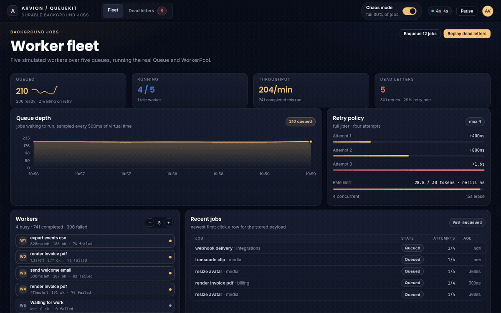
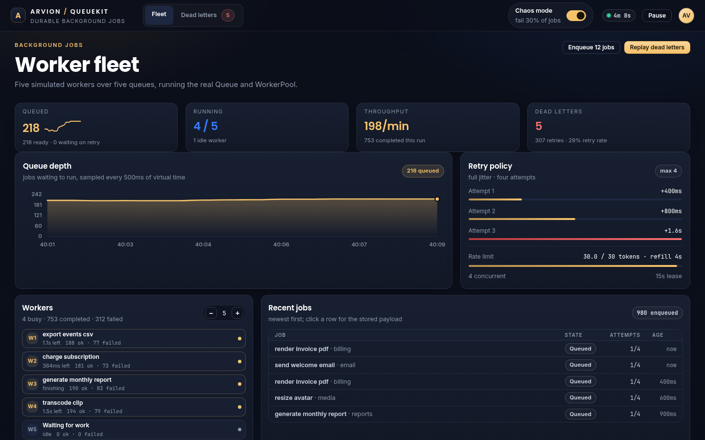
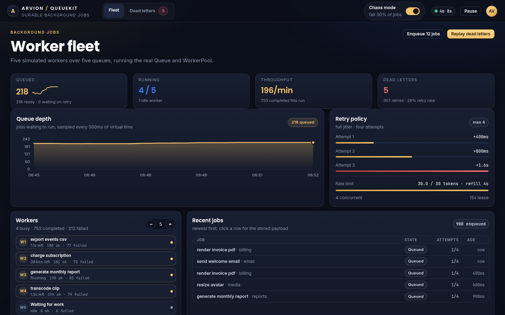

<div align="center">

</div>

<sub>Recorded from the live demo — <a href="docs/demo.mp4">MP4</a> · <a href="docs/screenshot.png">static frame</a></sub>

# QueueKit

A background job queue you can inspect while it runs. Durable storage, atomic
claims, retries with exponential backoff and jitter, concurrency and rate limits,
delayed and recurring jobs, a dead-letter queue with replay, and a dashboard that
shows which of those is currently hurting you.

[**Open the live demo**](https://arvion-technology.github.io/labs/demos/queuekit/demo/) · [MIT](LICENSE)

---

Most queue libraries are a Redis client and a worker loop. That is fine until a
job disappears, a worker dies mid-claim, or a retry storm hammers a service that
is already down. QueueKit starts from the failure cases: the claim is a single
storage operation, retry timing is a pure function you can test, and every job
state is visible rather than inferred.

The demo runs a fleet of five workers against the real `Queue`, `Scheduler` and
`WorkerPool` classes from `src/`, on a virtual clock. There is a chaos switch that
fails 30% of handler runs so you can watch retries and dead letters accumulate,
then replay them.

## What it does

- **Atomic claim** — one storage call hands a job to exactly one worker. The
  in-memory adapter does a compare-and-swap; the SQLite adapter does it in a
  single `UPDATE ... RETURNING`.
- **Retries with backoff** — base delay, multiplier, cap, attempt limit and three
  jitter modes. `full` jitter spreads a retry storm across the whole window
  instead of synchronising every worker.
- **Concurrency and rate limits** — a global in-process cap, optional per-queue
  caps, and a token bucket for claims.
- **Delayed and recurring jobs** — `runAt` handles one-off delays; a five-field
  cron parser and interval definitions feed the same queue as ordinary jobs.
- **Dead-letter queue** — exhausted jobs are parked with their last error and
  payload. Replay is manual and resets the attempt counter.
- **Lease recovery** — a worker that disappears leaves a job `running`; after the
  lease expires the job returns to the queue and spends one attempt.
- **CLI** — the same queue on a SQLite file: `init`, `enqueue`, `run`, `stats`,
  `dlq list`, `dlq replay`.

## Screenshots

| Worker fleet | Dead-letter queue |
| --- | --- |
|  |  |

## Architecture

```
                       ┌────────────────────────────┐
  enqueue / delay ───► │ Queue                      │
  recurring ─────────► │  ordering · limits · retry │
                       │  ack/fail · replay · metrics│
                       └─────────────┬──────────────┘
                                     │ claimNext / update
                       ┌─────────────▼──────────────┐
                       │ Storage adapter            │
                       │  MemoryStorage (tests/demo)│
                       │  SqliteStorage (CLI)       │
                       └─────────────┬──────────────┘
                                     │ running job
                       ┌─────────────▼──────────────┐
                       │ WorkerPool                 │
                       │  tick() claims → run → ack │
                       └─────────────┬──────────────┘
                                     │ events
                       ┌─────────────▼──────────────┐
                       │ Metrics → dashboard/CLI    │
                       └────────────────────────────┘
```

The demo imports `src/simulator.js`, which wires the real `Queue`, `Scheduler` and
`WorkerPool` classes to `MemoryStorage`. The CLI imports the same `Queue` with
`SqliteStorage`. Tests run both adapters through one contract suite.

A job is a plain object. The fields that matter:

```js
{
  id: "job_m8x2k1",       // unique; enqueue with a known id to stay idempotent
  name: "render_invoice", // your handler key
  queue: "billing",       // ordering and limits are per queue
  payload: { id: 42 },    // JSON-serialisable
  state: "queued",        // queued | running | completed | dead
  priority: 0,            // higher runs first
  attempts: 1,            // failures so far
  maxAttempts: 4,
  runAt: 1793200800000,   // not claimable before this timestamp
  leaseUntil: null,       // set while running
  lastError: null
}
```

Ordering is `priority DESC, runAt ASC, createdAt ASC` — priority first, then the
oldest due job, then insertion order. Both adapters express that as one sort.

## Quickstart

```bash
git clone https://github.com/arvion-technology/queuekit.git
cd queuekit
npm test                        # 41 tests, no dependencies
npm run demo                    # dashboard on http://localhost:4173
```

The CLI needs Node 22.5+ because it uses the built-in `node:sqlite` module:

```bash
node bin/queuekit.mjs init
node bin/queuekit.mjs enqueue render_invoice_pdf --payload '{"pages":3}' --count 3
node bin/queuekit.mjs enqueue send_welcome_email --priority 5
node bin/queuekit.mjs run --limit 20 --chaos 0.4
node bin/queuekit.mjs stats
node bin/queuekit.mjs dlq replay
```

There is nothing to install and no build step. `npm run demo` serves the static
folder; opening `demo/index.html` directly from disk will not work because it
imports ES modules from `../src/`.

## How it works

**The atomic claim lives in storage, not in the worker.** The queue decides *if* a
worker may claim (concurrency, rate limit), but the adapter decides *which* job
and guarantees it goes to one caller. `MemoryStorage.claimNext` filters claimable
jobs, sorts them and flips state in one synchronous step. `SqliteStorage` uses:

```sql
UPDATE jobs
   SET state = 'running', worker_id = ?, started_at = ?, lease_until = ?
 WHERE id = (SELECT id FROM jobs
              WHERE state = 'queued' AND run_at <= ? AND queue = ?
              ORDER BY priority DESC, run_at ASC, created_at ASC
              LIMIT 1)
   AND state = 'queued'
RETURNING *;
```

Two processes racing on one database cannot claim the same row, because the row
stops matching `state = 'queued'` as soon as the first update commits.

**Retry timing is a pure function.** `retryPlan(attempts, policy, now, random)`
returns the next `runAt` or `null` when the budget is spent. Jitter receives a
`random` function instead of calling `Math.random` internally, so tests pin the
schedule and production can seed it if needed. The cap is applied *before*
jitter, which makes `maxDelayMs` a real upper bound:

```js
import { retryPlan, normalisePolicy } from "./src/backoff.js";

const policy = normalisePolicy({ baseMs: 1_000, factor: 2, maxDelayMs: 60_000, jitter: "full" });
retryPlan(1, policy, 0, () => 0.5); // { delayMs: 500,  runAt: 500,  finalAttempt: false }
retryPlan(2, policy, 0, () => 0.5); // { delayMs: 1000, runAt: 1000, finalAttempt: false }
retryPlan(4, policy, 0, () => 0.5); // null → move to the dead-letter queue
```

**A lease is the recovery mechanism.** A claim sets `leaseUntil = now + leaseMs`.
If the process crashes, nothing moves the job; the next `releaseStale()` finds
expired leases and calls the same failure path as a handler error. That costs one
attempt on purpose: a job that reliably kills its worker must still end in the
DLQ instead of cycling forever.

**Recurring jobs are ordinary jobs.** The scheduler holds a definition with a
next-fire time and calls `queue.enqueue` when it is due. That means recurring
jobs inherit retries, limits and dashboard visibility. It also means the scheduler
is at-least-once: a long-running occurrence does not block the next one, so
handlers must be idempotent.

## Tests

```bash
npm test
```

41 tests across six files, all on `node:test`:

- `backoff.test.js` — policy validation, capped doubling, all three jitter modes,
  retry-plan exhaustion.
- `queue.test.js` — FIFO and priority ordering, delayed visibility, retry counts
  and exact backoff schedule, global and per-queue concurrency, rate limit refill,
  single ownership under two queue instances, duplicate ids, DLQ replay, lease
  expiry, ack/fail invariants, dashboard metrics.
- `storage-contract.test.js` — the same insert/claim/count/list contract against
  `MemoryStorage` and `SqliteStorage`.
- `scheduler.test.js` — cron parsing, UTC next-fire maths, POSIX OR semantics for
  day-of-month/day-of-week, interval catch-up behaviour.
- `worker-metrics.test.js` — pool respects the concurrency cap, retry → dead
  transitions through the pool, drain, resize, per-minute rates.
- `simulator.test.js` — seeded determinism, chaos → DLQ, pause, recurring
  registrations, snapshot shape.

## Limitations

- **Concurrency and rate limits are in-process.** Two CLI processes sharing one
  SQLite file will not share the global concurrency cap. The claim is still
  atomic, so jobs are never double-claimed; a distributed cap would need another
  coordination primitive and is not implemented.
- **SQLite is single-writer.** WAL mode and a 2s busy timeout handle normal
  contention, but this is a queue for a modest volume, not millions per second.
  The storage interface is the seam if you need Postgres or Redis.
- **The worker pool runs handlers synchronously** in the simulation. Real
  deployments would await a promise; the queue API does not care, but the demo
  is not a load test.
- **Cron is UTC-only and supports five fields.** No seconds, no timezone
  parameter, no `@reboot`-style macros. Local-time scheduling is how nightly jobs
  run twice or not at all during a DST change.
- **No job dependencies or workflows.** Jobs are independent. A job that needs
  three prior jobs to finish is an application-level concern here.
- **At-least-once delivery.** A worker can finish a job and die before `ack`; the
  lease will redeliver it. Handlers must be idempotent.

## Project layout

```
src/
  storage.js       job model, in-memory adapter, storage contract
  sqlite.js        durable adapter on node:sqlite (atomic UPDATE ... RETURNING)
  queue.js         enqueue, claim, ack/fail, retry, DLQ replay, metrics
  backoff.js       pure retry maths: policy, jitter, schedule
  scheduler.js     delayed jobs, interval definitions, cron parser
  worker.js        worker fleet: claim → busy → ack/fail
  metrics.js       rolling per-minute event counters
  simulator.js     deterministic demo fleet on a virtual clock
  states.js        the four-state machine and legal transitions
  prng.js          seeded PRNG for reproducible demos/tests
bin/queuekit.mjs   CLI: init, enqueue, run, stats, dlq
test/              node:test suites
demo/              dashboard, imports src/simulator.js
```

## Credits

Built by [Arvion Technologies](https://arviontech.net) in Kathmandu. MIT licensed.
